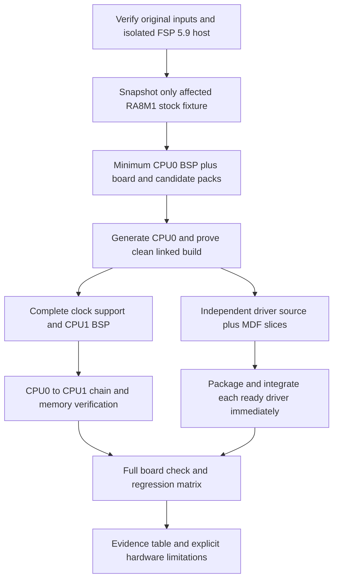

# EK-RA8P1 support in the FSP 5.9.0 baseline

## Outcome and boundaries

Implement a **custom, 5.9-derived RA8P1 support candidate**, not an official FSP 6.0 equivalent. Cover CPU0 BSP, CPU1 BSP, EK-RA8P1 board metadata, new MRAM/DAC/PDM support, and the watchdog/ADC/clock adaptations actually required by the hardware. Preserve existing FSP APIs, configuration defaults and older-device behavior.

- Follow [MIGRATION.md](../../MIGRATION.md), especially source boundaries (lines 18–66), incremental integration (78–88), and evidence requirements (90–105), plus [embedder.md](../../embedder.md).
- Inputs: original `baseline/`, original 5.9 packs/provenance, current vendor manuals/technical updates, supplied schematics, and bundled skills for workflow conventions. Do not consult the completed branch, old chats, prior-run artifacts, unrelated caches, or newer FSP implementation/metadata/header/SVD sources.
- The **only newer-FSP exception** is `.embedder/pin-model/`. Hash it before work, copy the supplied filenames and bytes unchanged into the MCU pack, and recheck hashes after packaging. Never invent, rename or extend its pin IDs.
- Modify owning FSP sources under `baseline/ra/` and MDFs under `baseline/module_descriptions/`; those are authoring inputs, unlike generated validation projects. Never repair generated project `ra/`, `ra_cfg/`, `ra_gen/`, linker output or application `configuration.xml` by hand.
- Use the provided isolated e2 support clone only. Candidate installation there is authorized; restoring stock, repairing the environment, and writing the real `~/.eclipse` or `/Applications` are not authorized.
- **No hardware operations**, including discovery/probing, serial, debugger attach, flash, reset or capture. All physical boot, timing, analog, audio, persistence and older-device runtime criteria remain **unverified**.

Planning has inspected repository inputs only. No current-run integrity verification, IDE invocation, build or host test is claimed yet; the committed `reference/verification.json` is historical baseline-integrity evidence only.

## Architecture and integration sequence

### 1. Establish the untouched starting point and controls

Steps 1–4 establish the required input/host preflight. Once step 2 passes, the header and pack-tooling children may start their separate new files while the parent completes host checks and the narrow RA8M1 snapshot in step 5; take that snapshot before changing the affected shared BSP/clock inputs. Step 6 is incremental regression work, not a prerequisite for the first CPU0 build:

1. Inspect current outer/nested working state and allowed inputs without reading other branches or ignored implementation artifacts. Keep nested `baseline/` HEAD at `5e8fbb10c752e16272790bd3a2587485d0377835`; do not reset, clean or commit it. Preserve unrelated edits and stop on unexpected starting content.
2. Confirm release archives are real archives, then run:
   - `python3 tools/verify_baseline.py --root .`
   - `python3 -m unittest discover -s tools -p 'test_*.py' -v`
   - Retain `validation/pre-change-baseline.json` using the verifier's `--report` option before any baseline edit. Do not overwrite `reference/verification.json`.
3. Verify the selected support root and inventory using `embedder e2 packs list`, `discover fsp-versions`, `discover boards --fsp 5.9.0`, and `packs verify --fsp 5.9.0`. Establish stock provenance with the preserved original archive if registration is needed; its expected SHA-256 is in `reference/provenance.json:13–17`. Confirm FSP 5.9 only and RA8P1 absent. Unexpected target support, FSP 6.x or pack/cache mismatches are blockers to report, **not permission to restore/repair**.
4. Record host version, complete GNU toolchain including libc headers, supported templates/debuggers, and isolated resource paths. Prefer the documented GNU 13.2.1 precedent when installed; do not silently substitute a compiler. Browse with `embedder e2 discover` because the candidate adds a device/core not present in stock.
5. Before the first CPU0 checkpoint, snapshot **only the affected stock EK-RA8M1 fixture** for the RA8 BSP/clock shared paths the CPU0 slice will change. Capture its configuration/defaults, relevant generated output, compiler options, memory/option-setting sections and the affected shared translation units. Do not preload a broad fixture matrix or expand the host suite before generating CPU0.
6. After the first CPU0 checkpoint, add stock controls **lazily as affected shared files change**: MCK-RA6T2 when `r_adc_b` is touched; RA8D1, RA4M2, RA4M1 and RA0E1 only when a changed shared file affects code/generation they actually compile. Verify actual pack/board availability and source dependency before creating each fixture. Capture only evidence relevant to that change, using retained pristine stock bytes for the comparison baseline, and finish the triggered regressions before declaring that slice's regression cell passed. Queue additional controls triggered by CPU0's shared changes for after its first checkpoint; they must not gate that first build. Compare object code/disassembly only for shared translation units actually changed, not whole-project disassemblies.

A failed baseline check blocks edits. A missing target-specific fact blocks that feature, not independent research/source work. Record the exact failing command and diagnostic. Retain pristine control sources/metadata and their original stock manifest when a fixture is first needed; a late stock comparison must use isolated stock inputs, never restore or alter the selected candidate support area.

### 2. Derive hardware facts and establish the owning inputs

Create a compact, cited device-difference/register inventory, keeping reproducible header-generation tools and their reviewed register inputs under proposed `tools/ra8p1/`, and reports/fixtures under proposed `validation/ra8p1/`. Keep new PDSC/toolingSupport/device/debug/memory/linker authoring assets under proposed `pack_sources/ra8p1/`; derive shared-pack edits from the original archive rather than hand-maintaining a second FSP tree. Derive hardware values from the RA8P1 hardware manual/datasheet and applicable technical updates, not from resemblance to another device.

- Use RA8M1 as the CPU0 CM85 structural template, cross-checked against RA8D1 for BSP macro/metadata completeness; use existing CM33 devices for core conventions. Reconcile every removed/changed sibling feature with a hardware citation. Do not fill unknown feature values with zero.
- No trusted RA8P1 register header/SVD is part of the permitted baseline. Delegate the CMSIS-style device-header generator and its manual-derived register inventory/checks immediately after input integrity is established. Deliver CPU0-required definitions first, then CPU1 and each driver's definitions incrementally. Require reproducible generation and `offsetof`/`sizeof`/mask checks for base addresses, access widths, offsets, array strides and reserved gaps. Do not fetch a newer pack's SVD or rename a sibling header and treat its registers as RA8P1 facts. Cover every register referenced by the BSP and selected production drivers before its generated-build gate; missing facts are explicit blockers.
- Add `bsp_elc.h`, `bsp_feature.h`, `bsp_mcu_info.h`, `bsp_override.h` and `bsp_peripheral.h` under proposed `baseline/ra/fsp/src/bsp/mcu/ra8p1/`, the device header under `baseline/ra/fsp/src/bsp/cmsis/Device/RENESAS/Include/`, and selection through the existing `renesas.h:45–115`. Keep shared startup, protection, interrupt, cache, module-stop and clock logic in their existing owners.
- Maintain a parent-owned capability registry. Any new feature macro must be defined consistently in every existing MCU's feature/peripheral headers with old-device values that preserve the prior path. Use capabilities/layout versions rather than RA8P1-name gates in shared drivers.
- Complete device, physical-part, FSP and events MDFs under proposed `Renesas##BSP##ra8p1##…` files. Preserve sibling property/interface/enum coverage, including absent-IP enums, and record justified parity differences. Do not advertise an unsupported peripheral stack merely because its pins exist.
- Scope orderable-part qualification to EK-RA8P1's **R7KA8P1KFLCAC** initially. All supplied pin-model files remain intact; their presence is not a claim that every part/package has been qualified.

### 3. Minimum CPU0 BSP: first real integration checkpoint

Implement only the coherent boot dependencies needed to generate and link CPU0 first, then expand the same owning files; do not wait for the peripheral drivers or a large host suite.

- Add CPU0 Cortex-M85 core selection, valid interrupt/event definitions, register protection/module-stop support, startup data/BSS handling, vector placement/alignment, clock initialization and frequency reporting, MRAM/SRAM/TCM memory description, option-setting metadata, and a minimal board definition/default pin table.
- Retain FSP 5.9 startup and public API conventions. Do not replace shared files with per-device forks, include-file implementations, no-op security/NMI handlers or success-returning stubs.
- Derive a legal board clock tree from its **24 MHz crystal** and hardware frequency/voltage constraints; retain the complete legal clock choices rather than only one hard-coded operating point. Minimum BSP clock changes and later `r_cgc` changes must use the same capability definitions and calculations.
- Construct candidate MCU/board packs and all affected shared-source pack copies from the original 5.9 archive and current owning sources; validate metadata and install using the process below.
- Discover EK-RA8P1 from that candidate, create a minimal bare-metal FLAT CPU0 project, run Generate Project Content, then a verified clean build. Fix the source/header/MDF/linker owner on failure and republish before retrying.
- Independently check the physical part, CM85 BSP selection, actual Cortex-M85 compiler/ABI flags, CPU0 debugger command, linked vectors and every ELF load range against the documented memory map. Do not infer identity from a project name or a green compile.

**Gate:** discoverable candidate, current-source hashes, no configurator errors, valid memory allocation and `verified: yes` with fresh linked artifacts. Immediately post the current slice table in one short checkpoint message, showing the real CPU0 build result or exact blocker and honest statuses for all other cells; then continue without waiting for acknowledgement. Do not delay this checkpoint for unrelated fixtures, full driver implementation or an expanded host suite.

### 4. Clock completion, CPU1 and the complete EK board

- Finish `r_cgc` and shared BSP clock support early: oscillator/PLL start-stop/stability, source/divider selection, CPU/peripheral frequency reporting and supported transitions. Invalid requests must fail before unsafe writes; preserve old-layout branches and clock-error NMI handling.
- Add CPU1 Cortex-M33 selection using the same physical device and thin per-core differences. Existing hooks are `renesas.h:135–147` and `bsp_security.c:39–43`, not a complete multicore implementation. CPU0 is the initial validation chain's boot owner; CPU1 consumes CPU0's Smart Bundle through `--preceding`. Use a CPU1 MRAM image partition for the initial pair, with its own vectors/RAM/stack; do not require code copying into TCM merely to build the minimum pair. CPU0 sets the secondary vector base, activates CPU1 and releases its wait state only after shared prerequisites are ready (HM §2.6, pp.117–118). Implement this in owned BSP code, not only a validation application. Alternative-primary-CPU and TCM-resident execution are separate coverage items, not implied passes.
- Define explicit CPU0/CPU1 image and RAM allocations in owned device/linker metadata, including stack/heap/vectors, aliases and any deliberately shared region. Use a straightforward disjoint split of the usable code MRAM and shared SRAM for these small fixtures; derive exact endpoints/reservations from the manual and retain them as checked inputs rather than guessed constants (HM §5.1, p.239). Prove physical disjointness, not just different virtual addresses. Each core initializes its own data/BSS and local memories; CPU0 owns global clock, board pins, shared SRAM ECC/security setup and option-setting image sections. CPU1 must not repeat that work or clear CPU0 data. Shared peripheral instances require exclusive core ownership; no new cross-core locking service is assumed.
- Add capability-gated CM33 C-TCM/S-TCM initialization/security handling in `baseline/ra/fsp/src/bsp/cmsis/Device/RENESAS/Source/system.c` and `baseline/ra/fsp/src/bsp/mcu/all/bsp_security.c`, with matching owned linker symbols. Existing startup only calls ITCM/DTCM initialization (`system.c:401–407`). CPU1 C-TCM and S-TCM are 64 KB each with different CPU-local and bus-master aliases (HM §2.17, pp.191–192); test alias normalization and ECC-before-use. Review RA8P1 OFS3 and other option words in `bsp_rom_registers.c`, without inheriting RA8M1's absence flags. No image is programmed.
- Build the pair through `embedder e2 build <cpu1-project> --rebuild` so its preceding dependency is checked in order. Check actual CM33 compiler/ABI, CPU1 BSP/register view, CPU1 debugger target, Smart Bundle freshness, option-memory ownership and both ELFs. A correct debugger device does not prove a correct compiler or linker.
- Complete proposed `baseline/ra/board/ra8p1_ek/` files and board MDF/default configuration. Use existing RA8 board layout for structure, but the actual schematic for routing and the supplied model for every pin ID. LEDs are P600/P303/PA07; switches P009/P008; PDM uses P502/P812; DAC A4 and ADC A0 are P014/P001; VCOM is SCI8 PD02/PD03. These differ from sibling mappings and must not be copied blindly.
- Include fitted-device routing and safe reset states where supported, correct I2C open-drain/high-speed pin attributes, and documented switch-dependent conflicts. Default routing must be a coherent switch configuration, not simultaneously enable mutually exclusive camera/display or OSPI/header functions. Leave boot/debug/system pins intact. Do not label the fitted GPY111 as the sibling's ICS1894 PHY or claim Ethernet support outside this scope.
- Use `embedder e2 pins … --fsp 5.9.0` before authoring pin settings; validate IDs and inspect the generated pin selections as evidence, never edit them. The supplied model already identifies the fitted microphone path as **PDM2** (`pdm2.pdmdat2.p502`, `pdm2.pdmclk2.p812`), A4 as `dac120.da0.p014`, and A0 as `p001.adc0.an001`—do not assume PDM0 or ADC channel 0 from connector names (`PinCfgR7KA8P1KxxCAC.xml:562,34845–34849,37205–37221`). Run `validate mdf` with BSP sibling parity and `board check <candidate> --board EK-RA8P1 --fsp 5.9.0` for both cores. Unknown pin IDs/build errors/configurator problems must be zero. Explain model informational differences rather than modifying the model.

### 5. Driver slices: source, MDF and immediate generated-build gates

Integrate any ready source/MDF pair immediately after CPU0 works. Preferred order is clock support, watchdog, MRAM, DAC/ADC, then PDM; independent preparation runs in parallel. Readiness, not completion of the whole batch, triggers packaging/generation. Exercise both cores where the documented access/security model permits, without implying simultaneous ownership.

- **`r_mram` (new):** derive write/protection/error/cache semantics and supported flash-style API operations from the MRAM chapter; retain explicit behavior for operations that do not exist on MRAM. Validate address aliases, legal windows, alignment, lengths, arithmetic overflow, protection and completion/error cleanup. Never generate a fixture that can overwrite its own code, vectors, option/security settings or an unreserved region. No memory test is executed on a device.
- **`r_dac_b` (new):** implement the actual DAC12 variant through the existing DAC API and an instance extension where needed. Test both channels, value/alignment limits, reference/output control, start/stop/close state, register protection and supported synchronized operation. Preserve existing `r_dac`/`r_dac8` selection and defaults.
- **`r_adc` acceptance slice:** first map hardware to the correct existing variant. The manual explicitly maps **ADC16H to ADC_B**, not the classic `r_adc` (RA8P1 HM Appendix 5, p.4293). Adapt `r_adc_b` if the register comparison requires it; do not rewrite classic ADC register templates or silently substitute driver identities. Review/test classic `r_adc` for regression and state exactly which files changed. Cover units/channels, scan groups/priority, result formats, conversion/clock limits, calibration, triggers, IRQs and invalid combinations. Document the single-ended overflow/offset/averaging limitation in TN-RA*-A0172A/E (2026-04-17, p.1); do not silently disable requested features or promise detection the silicon cannot provide.
- **`r_wdt`:** adapt the actual watchdog layout/channel/clock/option-setting differences while retaining the FSP5.9 API and existing NMI/group callback path. Test open/close/reopen, refresh sequencing, status clearing, timeout/window calculations, reset versus NMI mode, and parameter checking enabled/disabled. Do not confuse WDT and IWDT or treat debugger-stop behavior as runtime evidence.
- **`r_cgc`:** complete the early clock slice with every supported configuration exposed by its MDF, invalid source/divider/range cases, stability/timeout paths and rollback/ordering checks. Verify legal frequencies and error diagnostics at exact boundaries and just beyond them; constraints must actually trigger on deliberately invalid configurations.
- **`r_pdm` (new):** derive configuration and instance API from the PDM chapter and existing 5.9 streaming-driver conventions. Cover channel/edge selection, sample width/filter/decimation/clock combinations, buffer alignment/length/overflow, busy/stop/restart, FIFO/error callbacks and interrupt cleanup. Keep mutable transfer state instance-owned, define buffer ownership and ISR constraints, and handle DMA/cache alignment/coherency explicitly if transfer support is implemented. Generate an interrupt-driven capture project for the two fitted microphones; a compile is not microphone/audio-quality evidence.

For each slice: add production source/header and matching MDF together; discover its creatable stack; configure via `embedder e2 config set`; generate; clean-build a project that actually selects and references the driver; check generated configs/instances/vectors against production headers. **Post the checkpoint table immediately after this first generated-build attempt**, with remaining checks marked pending, then continue targeted host tests, required option/parameter-checking-on/off builds and lazily triggered older-device regressions without waiting for acknowledgement. Preserve 5.9 callback constness, TrustZone guards, ELC signals and defaults in shared MDFs.

## Candidate packs and source freshness

The pack-tooling child owns deterministic construction and manifest tooling; the parent owns installation/publication and serializes it against all generation/build jobs.

1. Delegate proposed `tools/build_ra8p1_packs.py` and its focused tests early, in parallel with the device-header task. It consumes the verified original archive, current owning source/metadata inputs and a parent-supplied output revision directory; it produces deterministic candidate archives, entry diffs and the required manifest without touching an IDE installation. Discover PDSC ownership from the original packs, preserve untouched archive entries, and propagate changed common files to **every owning pack**. Check component/MDF/PDSC/toolingSupport identity, file existence, dependency closure, conflicting ownership, safe paths and deterministic output. The child delivers the minimum CPU0 packaging path first, not a full generic packaging framework. Device/debug/memory support resources must be newly derived or adapted from permitted 5.9 inputs, not borrowed from newer packs.
2. Keep FSP5.9 platform/project identity and label the outputs as a custom candidate. For this explicitly requested same-version workflow, distinguish revisions with immutable candidate directories, manifests and archive hashes; never overwrite the preserved release or present patched bytes as stock. This is confined to the authorized isolated host, not a general release policy.
3. Preserve each revision's manifest **and matching pack bytes**. Manifest records must include whole-archive SHA-256 and every regular-entry SHA-256, as required by `embedder.md:69–94` and `tools/fsp_manifest.py:71–98`.
4. Validate all changed MDF/PDSC/toolingSupport/board configuration files with `embedder e2 validate mdf … --fsp 5.9.0`; require the validator canary to fire. Run BSP parity against ra8m1/ra8d1, resolving every missing ID with a hardware justification. Hunk-review shared MDFs because schema/reference checks cannot detect behavior losses.
5. Use `packs manifest` and review the builder's candidate-entry diff against the preserved originals. Run `packs install --manifest <revision-dir>` dry run, review it and apply its exact plan ID (with replacement consent flag when required). Then use `packs diff --fsp 5.9.0` to confirm installed deviations are precisely the intended candidate changes. Do not copy files directly into the support installation. Take the inventory/journal backups without restoring anything.
6. Verify **all three layers** after each update: installed archive hashes, extracted support resources, and each affected project's selected PDSC-owned source/linker hashes. Refresh only the stale layer using `packs refresh --fsp 5.9.0` or `packs refresh --project …`, dry run then approved apply. Preserve edited/unknown files; block rather than overwrite them. Regeneration or `--rebuild` alone is not freshness evidence.
7. Run the candidate's source/ELF verifier, regenerate and clean-build the affected slice immediately. Re-run final board checks and regressions against the last immutable manifest, not a mixture of pack revisions.

## Delegation and ownership

Use short, bounded handoffs with owned paths, agreed interfaces, cited inputs and focused checks. **Children report changed paths and focused test results only**, with an immediate concise blocker notification if necessary; do not return long source listings, research narratives or full logs to the parent. Keep detailed evidence in the owned files/logs for targeted inspection. No child may write the parent plan, pin model, generated projects, pack installation or another child's files.

- **Device-header specialist — launch early:** owns proposed `tools/ra8p1/generate_device_header.py`, its cited register-input files, `tools/test_ra8p1_device_header.py`, associated layout-check fixtures, and the new RA8P1 header file in `baseline/ra/fsp/src/bsp/cmsis/Device/RENESAS/Include/` (agree its basename before parallel edits). Does not edit `renesas.h`, shared BSP or capability headers. The parent supplies the CPU0 definition requirements and include contract; the child first delivers the CPU0-required header plus native/target-compiler `offsetof`, `sizeof` and mask-check results, then extends it as CPU1/driver facts are needed. No guessed registers or success stubs.
- **Pack-tooling specialist — launch alongside the header specialist:** owns proposed `tools/build_ra8p1_packs.py`, `tools/test_build_ra8p1_packs.py` and construction/manifest tooling only. Reuse `tools/fsp_manifest.py`'s contract; do not modify generic helpers or pack-owned source/MDF inputs without a separate handoff. Consume the original archive plus explicit current input paths and produce immutable output revisions/manifests/content diffs. Focused tests cover deterministic bytes, ownership closure, entry hashes and invalid/unsafe inputs. No pack install, support refresh, generation or IDE operation.
- **Parent/integrator:** minimal preflight/RA8M1 stock snapshot; shared BSP/capability registry; core/memory/debug resources; `renesas.h` integration; `r_cgc` and later `r_wdt`; installs/refresh/freshness verification; generated projects and checkpoint/final evidence. Review the delivered header/build-tool files and focused checks, but do not reimplement their generators or pull all their internals into the parent context.
- **Board/metadata specialist:** owns new `baseline/ra/board/ra8p1_ek/` and new RA8P1/board MDFs, against parent-agreed core/clock/capability contracts. Deliver minimum CPU0 metadata first, then CPU1/full board. The parent coordinates pack-owned PDSC/toolingSupport/core/debug/linker input changes separately from the pack-tooling child's code.
- **Memory/analog specialist:** owns new `r_mram` then `r_dac_b` source/instance headers/MDFs and their separate tests. Reuse existing APIs; request header/capability additions through the agreed owners rather than editing their files.
- **Acquisition specialist:** owns `r_pdm` and the hardware-correct ADC variant source/headers/MDFs plus their tests, integrating each separately. Do not edit classic `r_adc` unless documented evidence makes a change necessary.

Launch the header and pack-tooling children together as soon as the verified inputs/contracts are available, while the parent progresses the minimum BSP/integration. Start the board/metadata work early against that contract; schedule driver work as capacity becomes available without delaying CPU0. These are post-approval implementation assignments, not a fixed simultaneous agent count. Never have two writers own one file. Publication/generation remains parent-owned in one lane; if separate lanes are needed later, freeze pack revisions and stop workers before pack refresh. The parent inspects relevant actual diffs and check evidence rather than accepting a summary as proof. Do not duplicate or poll the existing read-only driver investigation; incorporate its result when it arrives.

## Verification and evidence

Proposed new artifacts: `tools/` header/pack/source-and-ELF verification utilities with focused tests; `validation/ra8p1/` source citations, generation specs, host fixtures, regression matrix and per-slice logs; immutable candidate-pack revision directories. Reuse committed generic helpers rather than replacing them. Avoid building a second IDE automation framework.

- **Host tests:** run committed tool tests before/after changes; test production driver C against controlled register fixtures, not a reimplementation of its algorithm. Add layout assertions and capability-set parity checks, null/invalid state/range/overflow cases, multiple instances, NMI/ISR/callback paths and rollback/timeout behavior. Use fault injection for unsupported combinations and failed pack extraction; preserve prior bytes/unknown edits on failures. Tests of mocked host APIs do not prove a live invocation works.
- **Generated builds:** each driver selected, generated instances/vectors linked, parameter checks on/off, relevant legal option combinations, invalid configurations rejected for the right reason. Exercise NMI and normal-interrupt metadata separately. Require zero errors, reviewed warnings, no new configurator problems and a verified clean linked artifact.
- **Independent identity/memory checks:** compare generated BSP core against compiler CPU/FPU/ABI flags and launch/debug target; inspect ELF architecture/vector/reset information and normalized physical PT_LOAD ranges, TCM aliases, stack/heap/data/BSS and option-setting ownership against manual-derived bounds. Two green builds are insufficient if they overlap or use the same core.
- **Older-device regressions:** add/regenerate only stock control fixtures whose compiled shared files or consumed metadata actually changed: RA8M1 for the initial BSP/clock work, RA6T2 when `r_adc_b` is touched, and RA8D1/RA4M2/RA4M1/RA0E1 lazily as their affected dependencies require. Compare relevant defaults/emitted configs, TrustZone guards/callback types/ELC signals and memory/OFS semantics. Limit object-code/disassembly and read-only-data comparisons to **changed shared translation units**; do not disassemble or compare every object in a fixture. Normalize debug/path noise but not executable behavior. Investigate differences; no silent baseline behavior change is accepted. Exercise parameter checks on/off and secure/non-secure generation where the changed path/guard requires them. New-only drivers must remain unavailable on unsupported older devices.
- **Metadata/board:** validator canary reported; no added schema/reference errors; every parity gap explained; zero unknown board pin IDs; `board check` succeeds for both cores. Test clock/module constraints with one violating and one valid configuration to detect inert constraints.
- **Host API fallback:** use `embedder e2` for discover, pins, configuration, generate, build, packs and validators. Only if a needed operation is missing, use `embedder e2 exec` with the verified host sequence from `embedder.md`, then the committed EASE helpers if necessary. Use the documented bundle-loaded debugger resolver/loader only when needed, revalidate it for the actual host, and dispose the loader. Never use numeric build-kind literals, jar inspection or guessed reflection APIs; fallback builds use exported `FULL_BUILD`/`CLEAN_BUILD`, verify clean removes the ELF, and require a zero-error full-build summary plus a fresh ELF (`tools/fsp_host.py:90–113`). Record a successful live host call before claiming API validity.
- **Checkpoint reporting:** after CPU0's first build checkpoint, CPU1's first generated/pair-build checkpoint, and **each driver's first generated-build checkpoint**, post the current nine-row slice table below in **one short message**, then immediately continue without waiting for acknowledgement. Show the actual outcome, including failure/blockers, and pending cells; do not wait for remaining option matrices, host tests or broader regressions to finish before posting. Keep cells terse with status and a short evidence reference; add at most a brief blocker note. A build pass does not turn pending source review, MDF validation, host tests or regressions into passes, and all hardware cells remain not run/unverified.
- **Evidence retention:** preserve exact commands, selected versions, manifest revision, diagnostics, `packs:`, `verified:` and `artifacts (stat from disk):` lines (including CPU0's preceding-project artifacts). Keep baseline integrity, host tests, generated builds and physical results distinct. Continue independent work while blockers are investigated; finish with the same table followed by limitations and intentional changes.

## Risks and stop conditions

- **Large new register/feature surface:** a minimal compile can hide missing definitions or wrong offsets. Require cited facts, layout tests, full macro parity and later comprehensive selected-driver builds; never unblock by inventing values or stubbing hardware.
- **First multicore addition to a single-core baseline:** core naming, shared initialization/security and aliased memory can be silently wrong. Require explicit ownership, dependency ordering, separate compiler/debugger checks and physical-range verification. Report unavailable host modeling as a blocker rather than hand-patching generated files.
- **Stale pack layers/duplicated shared files:** one old pack copy can invalidate both target and regression conclusions. Serialize installs and require three-layer provenance after every revision.
- **MDF validity versus completeness:** passing validators does not prove constraints, callbacks, guards or pin emission. Add parity, diff review, invalid-config tests and real generation/board checks.
- **Hardware-only truth:** host fixtures cannot establish clock stability, boot reliability, analog accuracy, MRAM endurance/persistence or microphone capture quality. Do not claim those passed.
- **Scope growth:** fitted Ethernet/display/camera/USB/OSPI hardware may need unrelated drivers. Provide correct board routing/limitations, not fabricated compatibility or an unrequested full-platform port. Unsupported commercial toolchains and untested packages are reported, not inferred from GNU success.

## Completion matrix

Use **one table in exactly this shape** for each checkpoint message and the final implementation report. Replace the planned entries below with real statuses: Pass, Fail, Blocked, In progress, Not started/Not run, or Not applicable, plus terse evidence references where available. Pending means pending, not failed or passed; hardware is always Not run / Unverified. Keep all nine rows and columns at every checkpoint so progress remains visible. The entries below describe planned evidence, not completed results.

| Slice | source | MDF | generated + clean build | validate mdf / board check | host tests | older-device regression | hardware (not run) |
|---|---|---|---|---|---|---|---|
| CPU0 BSP | New device/BSP plus capability-gated shared changes | Device/part/FSP/events and core identity | Minimal CM85 first; final current-pack rebuild | Schema, canary and justified sibling parity | Layout, capability, startup/clock ownership | RA8 sibling and non-RA8 shared-BSP controls | Unverified: boot, clock, reset |
| CPU1 BSP | CM33 view and secondary startup ownership | Core/debug/memory/dependency metadata | CPU0 → CPU1 pair; disjoint physical images | Both-core board check and metadata validation | Core selection, no double init, memory bounds | Existing CM33 and CM85 selection unchanged | Unverified: secondary start/IPC |
| EK-RA8P1 board | Board/LED/init files | Model-derived defaults and pin roles | Both-core minimal and driver projects | Zero unknown IDs; board check both cores | Pin/clock/reset mapping checks | Older board defaults unchanged | Unverified: electrical routing/output |
| r_mram | New driver and instance header | New stack/options/API bindings | Selected stack and callable API linked | MDF and pack ownership validated | Range/alignment/protection/error cases | Existing flash APIs and selection unchanged | Unverified: writes/persistence |
| r_dac_b | New DAC variant using DAC API | New capability-gated stack | Both channels/options selected | MDF and pin references validated | Values/state/reference/synchronization | Existing DAC/DAC8 output preserved | Unverified: analog output |
| r_pdm | New PDM capture driver | New stack/events/pin/clock choices | Real selected capture configuration | MDF/events/pins validated | Buffers/FIFO/state/error/callbacks | Unsupported devices cannot select it | Unverified: microphone/audio capture |
| r_wdt | Shared driver adaptation | Additive/default-preserving changes | Mode/parameter-check matrix | MDF/NMI metadata and negative constraints | Refresh/status/window/error/state | Old WDT emitted config and object comparison | Unverified: reset/NMI timing |
| r_adc | Correct ADC_B adaptation; classic ADC disposition explicit | Variant capabilities and preserved defaults | Scan/calibration/trigger configurations | MDF/events/clock constraints | Channels/groups/limits/errors/errata cases | Classic ADC and ADC_B control builds | Unverified: conversion/accuracy |
| r_cgc | Shared CGC and BSP clock owners | Complete target tree and gated constraints | Sources/dividers and both-core frequencies | Valid/invalid boundary configurations | Calculations/stability/transition/error cases | Old clocks/defaults/object comparison | Unverified: frequencies/stability |

### Remaining limitations to report

All target and older-device runtime criteria remain unverified because hardware is unavailable. Explicitly list any blocked source/MDF/build/test slice, unsupported API operation, untested core/security mode, non-EK part/package, unavailable compiler and unported fitted peripheral. Do not call baseline integrity or a linked ELF hardware qualification.

### Intentional behavior changes and reference deviations

The permitted reference is FSP5.9 sibling structure, not a newer RA8P1 implementation. New device/core/board selection, MRAM/DAC_B/PDM stacks and capability-gated RA8P1 behavior are intentional additions. The board's 24 MHz clock, 289-ball part, LED/switch/analog/PDM/SCI routing, dual-core ownership, MRAM-based image layout and actual peripheral variants intentionally differ from sibling references for hardware reasons; retain a cited deviation list as details are derived. ADC16H uses ADC_B as the vendor manual specifies. No existing public interface, callback contract, old-device default or option-memory behavior is intentionally changed. If implementation reveals a necessary externally visible incompatibility, stop and obtain a decision rather than silently changing this contract.
